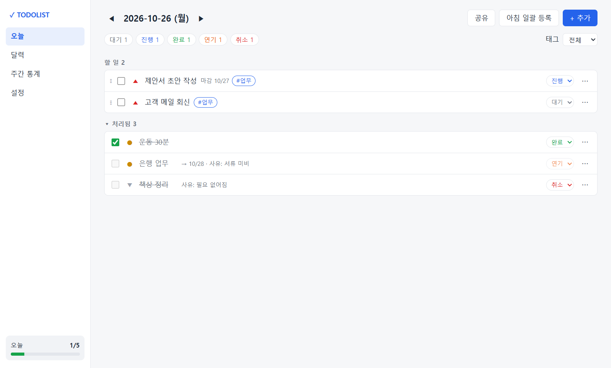
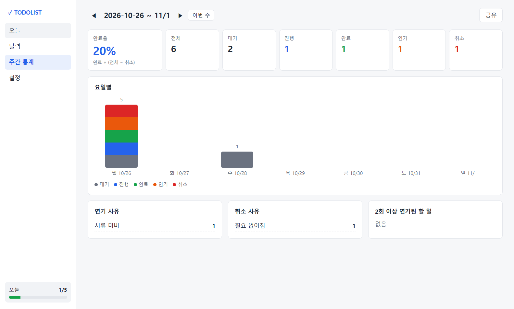
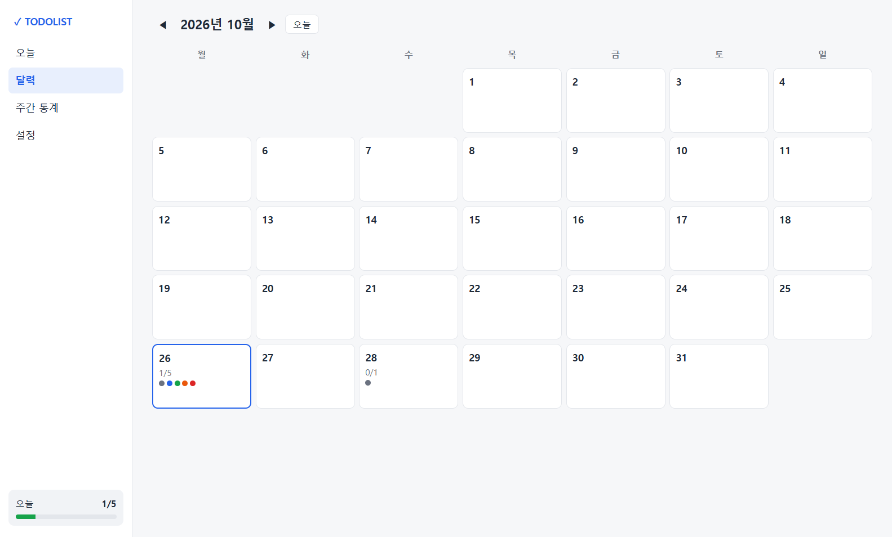
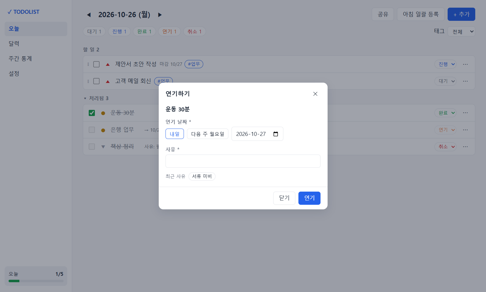
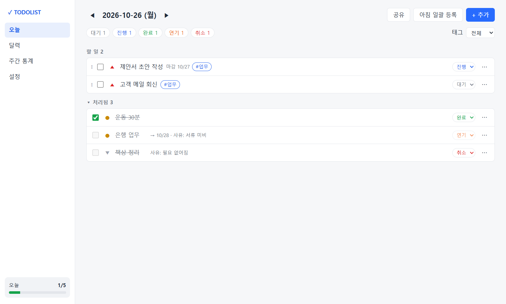

# TODOLIST

아침에 그날 할 일을 올리고, 우선순위대로 처리하며, 완료·연기·취소를 사유와 함께 기록해 한 주를 돌아보는 개인용 데스크톱 할 일 앱.

- 기획·설계 문서: [`docs/`](docs/) (PRD, 요구사항정의서, 화면설계서, ERD, API 명세서)
- 스택: Electron 45 + React 19 + TypeScript + Vite(electron-vite) + SQLite(sql.js)
- 다운로드: [Releases](https://github.com/jinnyworker/Todolist/releases) (Windows 설치 파일)



## 주요 기능

- **아침 일괄 등록** — 여러 줄을 붙여넣으면 한 줄당 한 건으로 오늘 목록에 추가
- **우선순위** — 높음/보통/낮음 + 같은 등급 안에서 드래그로 순서 변경
- **상태 5단계** — 대기·진행·완료·연기·취소, 완료는 체크박스 한 번
- **연기·취소 사유** — 연기하면 새 날짜에 "연기됨" 표시로 옮겨지고 원래 날짜에는 사유가 남음
- **달력 · 주간 통계** — 날짜별 진행 현황, 완료율, 요일별 추이, 연기·취소 사유, 반복해서 밀린 일
- **공유** — 하루 목록·주간 통계를 텍스트 또는 이미지로 복사·저장
- **마감일 · 반복 · 태그 · 알림**, 트레이 상주, 로컬 저장(외부 전송 없음)

| 주간 통계 | 달력 |
|---|---|
|  |  |
| **연기 사유 입력** | **이미지 공유** |
|  |  |

## 실행

```bash
npm install          # 처음 한 번
npm run dev          # 개발 모드 (핫 리로드)
npm run build        # out/ 에 빌드
npm start            # 빌드 결과 실행
```

## 검증

```bash
npm run typecheck    # Main·Preload·Renderer 타입 검사
npm test             # 서비스 단위 테스트 (vitest)
npm run smoke        # 빌드 후 실제 앱을 띄워 렌더링·IPC·보안 설정 확인 후 종료
```

스모크 테스트는 임시 폴더를 데이터 폴더로 써서 실제 데이터에 영향이 없다. `TODOLIST_SMOKE_SHOTS=<폴더>`를 주면 주요 화면과 모달을 PNG로 저장한다.

## 설치 파일

```bash
npm run dist         # release/TODOLIST Setup x.y.z.exe (Windows NSIS)
npm run dist:dir     # 설치 없이 release/win-unpacked/ 만 생성
```

코드 서명 인증서가 없어 처음 실행할 때 Windows SmartScreen 경고가 뜰 수 있다.

## 사용 메모

- 창의 ✕를 누르면 트레이로 숨는다. 완전 종료는 트레이 아이콘 우클릭 → "종료".
- 데이터 위치: `%APPDATA%\todolist\todolist.db`. 설정 → 백업에서 DB 파일이나 JSON으로 내보낼 수 있다.
- 단축키 (목록 화면): `Ctrl+N` 추가, `Ctrl+Shift+N` 아침 일괄 등록, `←` `→` 하루 이동, `T` 오늘. 일괄 등록 창에서 `Ctrl+Enter` 등록.

## 구조

```
src/
  main/            Electron Main: 창·트레이·알림 스케줄러, IPC 핸들러
    db/            sql.js 래퍼, 스키마
    services/      할 일·통계·태그·반복·설정·공유 로직 (단위 테스트 대상)
  preload/         contextBridge로 window.electronAPI 노출
  renderer/        React 화면 (pages: 오늘·달력·통계·설정, components: 모달 등)
  shared/          IPC 채널 상수, 타입, 날짜·일괄 등록 유틸
tests/             vitest 단위 테스트
```

## 라이선스

[MIT](LICENSE)
