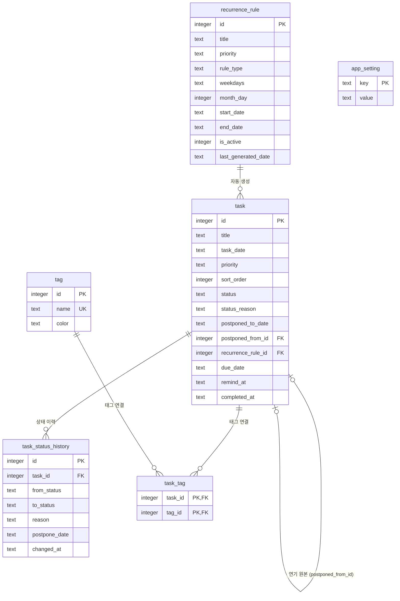

# TODOLIST ERD · 테이블 정의서

## 1. 개요

| 항목 | 내용 |
|---|---|
| DBMS | SQLite 3. Electron Main 프로세스에서 sql.js(WebAssembly)로 접근한다. 네이티브 빌드 도구 없이 동작하고 Node 테스트와 앱이 같은 드라이버를 쓴다. 메모리에서 작업하고 변경 API가 성공할 때마다 파일에 저장한다(임시 파일에 쓴 뒤 교체). 파일 위치: `app.getPath('userData')/todolist.db` |
| 스키마 버전 | `PRAGMA user_version` (현재 1). 코드: `src/main/db/schema.ts` |
| 명명 규칙 | 테이블·컬럼 `snake_case`, 테이블명 단수형, PK는 `id` |
| 공통 컬럼 | `created_at`, `updated_at` (모든 테이블). 예외: `task_tag`는 `created_at`만, `app_setting`은 `updated_at`만 둔다. 값은 앱이 ISO 8601 UTC로 기록한다 |
| 문자셋 · 시간대 | UTF-8. 날짜(`*_date`)는 로컬 날짜 `YYYY-MM-DD`, 일시(`*_at`)는 ISO 8601 UTC 문자열로 저장하고 화면에서 로컬 시간으로 바꾼다 |
| 관련 문서 | 요구사항정의서, API 명세서 |

## 2. ERD

## 3. 테이블 목록

| 테이블명 | 한글명 | 설명 | 관련 REQ | 예상 건수 |
|---|---|---|---|---|
| task | 할 일 | 날짜별 할 일. 연기하면 새 날짜에 행을 하나 더 만든다 | REQ-1~13, REQ-16 | 연 4천 건 (하루 10건 기준, 추정) |
| task_status_history | 상태 이력 | 상태 변경마다 한 행 (사유·연기 날짜 포함) | REQ-6~9, REQ-12 | 연 1만 건 (추정) |
| tag | 태그 | 사용자가 만든 태그 | REQ-15 | 수십 건 |
| task_tag | 할 일-태그 | 할 일과 태그의 다대다 연결 | REQ-15 | 연 수천 건 |
| recurrence_rule | 반복 규칙 | 반복 할 일을 만드는 규칙 | REQ-14 | 수십 건 |
| app_setting | 앱 설정 | 알림 등 키-값 설정 | REQ-16 | 10건 이하 |

## 4. 테이블 정의

### task (할 일)

| 컬럼명 | 한글명 | 타입 | NULL | 키 | 기본값 | 설명 |
|---|---|---|---|---|---|---|
| id | ID | INTEGER | N | PK | 자동 증가 | |
| title | 제목 | TEXT | N | | | 1~200자 |
| memo | 메모 | TEXT | Y | | | 2,000자 이하 |
| task_date | 날짜 | TEXT | N | | | 이 할 일이 표시되는 날짜 `YYYY-MM-DD`. 목록·달력·통계 집계 기준 |
| priority | 우선순위 | TEXT | N | | 'normal' | high / normal / low |
| sort_order | 순서 | INTEGER | N | | 0 | 같은 날짜·같은 등급 안의 표시 순서 (작을수록 위) |
| status | 상태 | TEXT | N | | 'waiting' | waiting / in_progress / done / postponed / canceled |
| status_reason | 상태 사유 | TEXT | Y | | | 연기·취소 사유 (최근 값). 전체 이력은 task_status_history |
| postponed_to_date | 연기 날짜 | TEXT | Y | | | 연기된 원본에만 값. 새 날짜 표시용 |
| postponed_from_id | 연기 원본 ID | INTEGER | Y | FK → task.id | | 연기로 생긴 할 일이 가리키는 원본. 원본 삭제 시 NULL |
| recurrence_rule_id | 반복 규칙 ID | INTEGER | Y | FK → recurrence_rule.id | | 반복 규칙으로 생성된 경우. 규칙 삭제 시 NULL |
| due_date | 마감일 | TEXT | Y | | | `YYYY-MM-DD` |
| remind_at | 알림 일시 | TEXT | Y | | | 알림 시각 (ISO 8601) |
| completed_at | 완료 일시 | TEXT | Y | | | status가 done일 때만 값 |
| created_at | 생성일시 | TEXT | N | | 앱에서 기록 | |
| updated_at | 수정일시 | TEXT | N | | 앱에서 기록 | |

**인덱스**

| 인덱스명 | 컬럼 | 유형 | 용도 |
|---|---|---|---|
| idx_task_date_order | task_date, priority, sort_order | btree | 날짜별 목록 조회·정렬 (API-01) |
| idx_task_date_status | task_date, status | btree | 달력 요약, 주간 통계 (API-09, API-10) |
| idx_task_postponed_from_id | postponed_from_id | btree | 연기 이력 추적, 반복 연기 집계 |
| uq_task_recurrence_date | recurrence_rule_id, task_date | unique (recurrence_rule_id IS NOT NULL 조건) | 같은 규칙이 같은 날짜에 두 번 생성되지 않게 막음 |
| idx_task_remind_at | remind_at | btree | 알림 스케줄 조회 |

**처리 규칙**

- 연기: 원본은 `status = postponed`, `status_reason`, `postponed_to_date`를 기록한다. 새 날짜에 `title`, `memo`, `priority`, 태그를 복사한 행을 `status = waiting`, `postponed_from_id = 원본 id`, `recurrence_rule_id = NULL`로 만든다.
- 완료 해제: task_status_history에서 직전 상태를 찾아 되돌린다.
- 삭제: 실제 행을 지운다. task_status_history, task_tag는 함께 지운다(ON DELETE CASCADE).

### task_status_history (상태 이력)

| 컬럼명 | 한글명 | 타입 | NULL | 키 | 기본값 | 설명 |
|---|---|---|---|---|---|---|
| id | ID | INTEGER | N | PK | 자동 증가 | |
| task_id | 할 일 ID | INTEGER | N | FK → task.id | | ON DELETE CASCADE |
| from_status | 이전 상태 | TEXT | Y | | | 생성 시 NULL |
| to_status | 새 상태 | TEXT | N | | | task.status 값과 같은 코드 |
| reason | 사유 | TEXT | Y | | | 연기·취소 시 필수 (앱에서 검증) |
| postpone_date | 연기 날짜 | TEXT | Y | | | to_status가 postponed일 때 |
| changed_at | 변경일시 | TEXT | N | | 앱에서 기록 | |
| created_at | 생성일시 | TEXT | N | | 앱에서 기록 | |
| updated_at | 수정일시 | TEXT | N | | 앱에서 기록 | |

**인덱스**

| 인덱스명 | 컬럼 | 유형 | 용도 |
|---|---|---|---|
| idx_task_status_history_task_id | task_id, changed_at | btree | 할 일별 이력 조회 (API-08) |
| idx_task_status_history_reason | to_status, changed_at | btree | 최근 사유, 주간 사유 집계 |

### tag (태그)

| 컬럼명 | 한글명 | 타입 | NULL | 키 | 기본값 | 설명 |
|---|---|---|---|---|---|---|
| id | ID | INTEGER | N | PK | 자동 증가 | |
| name | 이름 | TEXT | N | UK | | 1~20자 |
| color | 색 | TEXT | Y | | | `#RRGGBB` |
| created_at | 생성일시 | TEXT | N | | 앱에서 기록 | |
| updated_at | 수정일시 | TEXT | N | | 앱에서 기록 | |

**인덱스**

| 인덱스명 | 컬럼 | 유형 | 용도 |
|---|---|---|---|
| uq_tag_name | name | unique | 중복 이름 방지 |

### task_tag (할 일-태그)

| 컬럼명 | 한글명 | 타입 | NULL | 키 | 기본값 | 설명 |
|---|---|---|---|---|---|---|
| task_id | 할 일 ID | INTEGER | N | PK, FK → task.id | | ON DELETE CASCADE |
| tag_id | 태그 ID | INTEGER | N | PK, FK → tag.id | | ON DELETE CASCADE |
| created_at | 생성일시 | TEXT | N | | 앱에서 기록 | |

**인덱스**

| 인덱스명 | 컬럼 | 유형 | 용도 |
|---|---|---|---|
| idx_task_tag_tag_id | tag_id | btree | 태그 필터 |

### recurrence_rule (반복 규칙)

| 컬럼명 | 한글명 | 타입 | NULL | 키 | 기본값 | 설명 |
|---|---|---|---|---|---|---|
| id | ID | INTEGER | N | PK | 자동 증가 | |
| title | 제목 | TEXT | N | | | 생성될 할 일 제목 |
| memo | 메모 | TEXT | Y | | | |
| priority | 우선순위 | TEXT | N | | 'normal' | high / normal / low |
| rule_type | 반복 유형 | TEXT | N | | | daily / weekdays / weekly / monthly |
| weekdays | 요일 | TEXT | Y | | | weekly일 때 `1,3,5` (1=월 … 7=일) |
| month_day | 일자 | INTEGER | Y | | | monthly일 때 1~31. 없는 날은 그달 말일 (추정) |
| start_date | 시작일 | TEXT | N | | | |
| end_date | 종료일 | TEXT | Y | | | NULL이면 계속 |
| is_active | 사용 여부 | INTEGER | N | | 1 | 0이면 생성 중지 |
| last_generated_date | 마지막 생성일 | TEXT | Y | | | 앱 실행 시 이 날짜 다음부터 오늘(+미리 생성 범위)까지 생성 |
| created_at | 생성일시 | TEXT | N | | 앱에서 기록 | |
| updated_at | 수정일시 | TEXT | N | | 앱에서 기록 | |

> TODO: 반복 할 일에 태그를 자동으로 붙일지 확인. 필요하면 `recurrence_rule_tag` 테이블을 추가한다.

### app_setting (앱 설정)

| 컬럼명 | 한글명 | 타입 | NULL | 키 | 기본값 | 설명 |
|---|---|---|---|---|---|---|
| key | 설정 키 | TEXT | N | PK | | 코드 값 정의 참고 |
| value | 값 | TEXT | N | | | 문자열로 저장 |
| updated_at | 수정일시 | TEXT | N | | 앱에서 기록 | |

## 5. 코드 값 정의

| 코드 그룹 | 코드 | 의미 |
|---|---|---|
| task.status | waiting | 대기 |
| | in_progress | 진행 |
| | done | 완료 |
| | postponed | 연기 |
| | canceled | 취소 |
| task.priority | high | 높음 |
| | normal | 보통 |
| | low | 낮음 |
| recurrence_rule.rule_type | daily | 매일 |
| | weekdays | 평일 (월~금) |
| | weekly | 매주 지정 요일 |
| | monthly | 매월 지정 일자 |
| app_setting.key | morning_reminder_enabled | 아침 등록 알림 사용 (`true`/`false`) |
| | morning_reminder_time | 아침 등록 알림 시각 (`HH:mm`) |
| | task_reminder_enabled | 할 일별 알림 사용 (`true`/`false`) |
| | morning_reminder_last_date | (내부) 아침 알림을 마지막으로 띄운 날짜. 하루 한 번만 띄우는 데 쓴다 |
| | tray_notice_shown | (내부) "트레이에서 계속 실행됩니다" 안내를 이미 띄웠는지 |

## 6. 데이터 보관 · 보안

| 항목 | 내용 |
|---|---|
| 개인정보 컬럼 | 없음 (개인 메모 성격의 title, memo만 저장) |
| 보관 기간 | 사용자가 지울 때까지 보관 |
| 백업 주기 | 수동 내보내기 (API-19). TODO: 자동 백업 필요 여부 확인 |

## 변경 이력

| 버전 | 날짜 | 작성자 | 변경 내용 |
|---|---|---|---|
| 0.1 | 2026-10-26 | Jinny | 최초 작성 |
| 0.2 | 2026-10-26 | Jinny | DBMS 접근 방식·파일 위치 확정 (Electron + better-sqlite3) |
| 0.3 | 2026-10-26 | Jinny | 구현 반영: 드라이버를 sql.js로 변경(네이티브 빌드 불필요), 일시 컬럼은 앱에서 기록, 내부 설정 키 2개 추가 |
