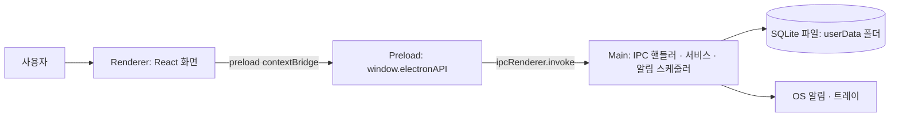

# TODOLIST PRD

## 0. 한눈에 보기

| 항목 | 내용 |
|---|---|
| 한 줄 정의 | 아침에 그날 할 일을 올리고, 우선순위대로 처리하며, 완료·연기·취소를 사유와 함께 기록해 한 주를 돌아보는 개인용 데스크톱 할 일 앱 |
| 대상 사용자 | 본인 (1인 개인 사용) |
| 사업 유형 | 자체 |
| 목표 일정 | 정하지 않음 (기한 없이 진행) |
| 성공 기준 | TODO: 예) 4주 연속 매일 아침 등록, 주간 완료율 확인 습관화 |

## 1. 배경

### 1.1 시장·사용자 상황

매일 할 일을 적어두지만, 하루가 끝났을 때 무엇을 했고 무엇을 못 했는지, 무엇이 먼저였는지 한눈에 확인하기 어렵다.

### 1.2 기존 방식의 불편함

| 현재 방식 | 불편한 점 | 영향 |
|---|---|---|
| TODO: 지금 할 일을 적는 방식 (메모장, 종이, 다른 앱 등) | 완료 여부만 남고 미뤄진 이유·취소 이유가 남지 않음 (추정) | 같은 일이 반복해서 밀려도 원인을 알 수 없음 |
| | 우선순위를 정해 두지 않으면 급한 일과 중요한 일이 섞임 | 중요한 일을 놓침 |
| | 주 단위로 얼마나 끝냈는지 집계되지 않음 | 업무량·습관을 돌아보기 어려움 |

## 2. 문제 정의

### 2.1 사용자 문제

- 하루를 마칠 때, 할 일마다 완료했는지 안 했는지 확인하기 어렵다.
- 할 일이 여러 개일 때, 어떤 것을 먼저 해야 하는지 정해 두지 않아서 순서가 흐트러진다.
- 일을 미루거나 취소할 때, 이유와 미룬 날짜가 남지 않아서 나중에 다시 챙기지 못한다.

### 2.2 비즈니스·제품 문제

- 등록이 번거로우면 매일 쓰지 않게 된다. 아침에 빠르게 한 번에 올릴 수 있어야 한다.
- 상태(대기/진행/완료/연기/취소)가 정확히 기록되어야 주간 통계가 의미를 가진다.

## 3. 제품 기회와 목표

### 3.1 제품 기회

할 일의 "결과"(완료·연기·취소)와 "이유"를 함께 남기면, 하루 관리 도구를 넘어 한 주를 돌아보는 기록이 된다.

### 3.2 목적 · 특징 · 장점

| 구분 | 내용 |
|---|---|
| 목적 | 매일 할 일을 우선순위대로 처리하고, 그 결과를 주 단위로 확인한다 |
| 특징 | 아침 일괄 등록, 우선순위 지정, 5단계 상태값, 연기·취소 사유 기록, 연기된 날짜로 자동 이동, 주간 통계 |
| 장점 (경쟁 대비) | 연기·취소 사유와 연기 이력을 남김. 오프라인 로컬 저장으로 개인 데이터가 PC 밖으로 나가지 않음 |

### 3.3 범위

| 포함 (In scope) | 제외 (Out of scope) |
|---|---|
| 할 일 등록·수정·삭제, 아침 일괄 등록 | 다중 사용자, 팀 협업 |
| 우선순위, 상태값, 완료 체크, 연기·취소 사유 | 클라우드 동기화, 모바일 앱 (추정, 확인 필요) |
| 당일 목록, 달력 날짜 이동, 주간 통계 | 외부 캘린더 연동 (추정, 확인 필요) |
| 마감일, 반복, 태그, 알림 (권장) | |
| 공유: 하루 목록·주간 통계를 텍스트 또는 이미지로 (선택) | 지난 할 일의 다음 날 자동 이월 |

## 4. 대상 사용자

| 사용자 유형 | 설명 | 주요 목표 | 사용 환경 |
|---|---|---|---|
| 개인 사용자 (본인) | 매일 할 일을 직접 계획하고 처리 | 하루 할 일을 우선순위대로 끝내고 주간 결과 확인 | Windows 데스크톱 (추정) |

## 5. 핵심 사용자 시나리오

1. **아침 등록.** 앱을 열면 오늘 목록(SCR-01)이 보인다. "아침 일괄 등록"(SCR-03)에 오늘 할 일을 여러 줄로 붙여넣어 한 번에 올린다.
2. **우선순위 선정.** 목록에서 항목마다 높음/보통/낮음을 정하고 드래그로 순서를 맞춘다.
3. **진행·완료.** 시작한 일은 "진행"으로 바꾸고, 끝난 일은 체크박스로 완료 처리한다.
4. **연기.** 오늘 못 할 일은 "연기"를 누르고 사유와 새 날짜를 입력한다(SCR-04). 그 일은 새 날짜 목록에 "연기됨" 표시로 나타난다.
5. **취소.** 하지 않기로 한 일은 "취소"를 누르고 사유를 입력한다(SCR-04).
6. **다른 날짜 보기.** 달력(SCR-05)에서 이전·이후 날짜를 골라 그날 목록을 본다.
7. **주간 확인.** 주간 통계(SCR-06)에서 이번 주 완료/진행/대기/연기/취소 건수와 완료율을 본다.

## 6. 기능 요구사항 요약

| 기능 묶음 | 설명 | 우선순위 | 관련 REQ |
|---|---|---|---|
| 할 일 관리 | 등록·수정·삭제, 아침 일괄 등록 | 필수 | REQ-1, REQ-2, REQ-3, REQ-4 |
| 우선순위 | 등급 지정과 순서 변경 | 필수 | REQ-5 |
| 상태·결과 기록 | 5단계 상태, 완료 체크, 연기·취소 사유 | 필수 | REQ-6, REQ-7, REQ-8, REQ-9 |
| 날짜별 보기 | 당일 목록, 달력 이동 | 필수 | REQ-10, REQ-11 |
| 주간 통계 | 상태별 건수, 완료율, 요일별 추이 | 필수 | REQ-12 |
| 부가 기능 | 마감일, 반복, 태그, 알림 | 권장 | REQ-13, REQ-14, REQ-15, REQ-16 |
| 공유 | 하루 목록·주간 통계를 텍스트 또는 이미지 중 골라 공유 | 선택 | REQ-17 |
| 저장·실행 환경 | 로컬 저장, 데스크톱 실행 | 필수 | REQ-18, REQ-19 |

## 7. 비기능 요구사항

| 구분 | 요구 수준 |
|---|---|
| 성능 | 앱 실행 후 오늘 목록 표시 2초 이내, 상태 변경 즉시 반영 (추정) |
| 보안·개인정보 | 데이터는 PC 로컬에만 저장. 외부 전송 없음 |
| 가용성 | 인터넷 연결 없이 모든 기능 동작 |
| 호환성 (기기, 브라우저) | Windows 10/11 (추정, 확인 필요). Electron 기반이라 이후 macOS 빌드도 가능 |

## 8. 도입 전후 (Before / After)

| 항목 | 도입 전 | 도입 후 | 측정 방법 |
|---|---|---|---|
| 하루 결과 확인 | 완료 여부가 따로 남지 않음 | 할 일마다 상태와 사유가 남음 | 상태 기록 비율 |
| 미룬 일 추적 | 미룬 일을 기억에 의존 | 새 날짜 목록에 자동 표시 | 연기 건 중 재처리 비율 |
| 주간 회고 | TODO: 현재 회고 방식 | 주간 통계 화면에서 바로 확인 | 주간 완료율 |

## 9. MVP 범위

### 9.1 MVP에 포함하는 기능

- 아침 일괄 등록 (REQ-4)과 개별 등록·수정·삭제 (REQ-1~3)
- 우선순위 지정 (REQ-5)
- 상태값 관리와 완료 체크 (REQ-6, REQ-7)
- 연기·취소 사유 입력, 연기된 날짜에 표시 (REQ-8, REQ-9)
- 당일 목록, 달력 이동 (REQ-10, REQ-11)
- 주간 통계 (REQ-12)
- 로컬 저장, 데스크톱 실행 (REQ-18, REQ-19)

### 9.2 MVP 화면

| SCR ID | 화면명 | 핵심 기능 |
|---|---|---|
| SCR-01 | 오늘 할 일 (메인) | 날짜별 목록, 완료 체크, 우선순위·순서, 상태 변경 |
| SCR-02 | 할 일 등록·수정 | 제목·날짜·우선순위·메모 입력 |
| SCR-03 | 아침 일괄 등록 | 여러 줄 입력으로 한 번에 등록 |
| SCR-04 | 연기·취소 사유 입력 | 사유, 연기 날짜 입력 |
| SCR-05 | 달력 | 월 단위 날짜 선택, 날짜별 건수 표시 |
| SCR-06 | 주간 통계 | 상태별 건수, 완료율, 요일별 추이 |
| SCR-07 | 설정 | 태그·반복·알림 관리, 백업 (권장 기능용) |
| SCR-08 | 공유 | 텍스트/이미지 형식 선택 후 복사·저장 (선택 기능용) |

## 10. 검증할 가설과 지표

| 가설 | 검증 방법 | 지표 | 성공 기준 |
|---|---|---|---|
| 아침에 한 번에 올릴 수 있으면 매일 등록을 거르지 않는다 | 4주 직접 사용 | 등록한 날 수 / 평일 수 | TODO: 예) 90% 이상 |
| 우선순위를 먼저 정하면 높음 항목의 완료율이 올라간다 | 우선순위별 완료율 비교 | 높음 항목 완료율 | TODO |
| 연기 사유를 남기면 같은 일이 반복해서 밀리는 것을 알아챈다 | 연기 이력 확인 | 2회 이상 연기된 건 수 추이 | TODO |
| 주간 통계를 보면 다음 주 계획량을 조정한다 | 주간 등록 건수 변화 | 주간 완료율 | TODO |

## 11. 시스템·인프라 개요

서버 없이 혼자 실행되는 Electron 데스크톱 앱이다. Renderer(React 화면)는 preload가 노출한 API만 호출하고, Main 프로세스가 IPC로 받아 SQLite 파일에 저장한다. 알림·트레이도 Main 프로세스가 맡는다.

| 구성 요소 | 기술 / 서비스 | 비고 |
|---|---|---|
| 프론트엔드 | React + TypeScript + Vite | Renderer 프로세스. Node API 직접 접근 금지 |
| 백엔드 | Electron Main 프로세스 (TypeScript) | 별도 서버 없음. `contextIsolation: true`, `nodeIntegration: false`, `sandbox: true` |
| DB | SQLite (sql.js, WebAssembly) | 앱 userData 폴더의 로컬 파일. 네이티브 빌드 도구 없이 동작 |
| 알림 · 트레이 | Electron `Notification`, `Tray` | 창을 닫으면 트레이로 숨고 알림은 계속 동작. 완전 종료는 트레이 메뉴의 "종료" |
| 배포 환경 | electron-builder, Windows NSIS 설치 파일 | 자동 업데이트는 MVP 제외 (추정) |

## 12. 일정 · 마일스톤

| 마일스톤 | 목표일 | 산출물 |
|---|---|---|
| 기획·설계 완료 | 정하지 않음 | PRD, 요구사항정의서, 화면설계서, ERD, API 명세서 |
| MVP 개발 완료 | 정하지 않음 | 설치 파일 |
| 4주 사용 검증 | MVP 완료 후 4주 | 가설 검증 결과 |

## 13. 리스크와 대응

| 리스크 | 가능성 | 영향 | 대응 방안 |
|---|---|---|---|
| 등록이 번거로워 사용이 끊김 | 중 | 상 | 일괄 등록, 아침 알림, 단축키 |
| 로컬 파일 손상·PC 교체로 데이터 유실 | 하 | 상 | 백업 내보내기 (REQ-18) |
| 반복 할 일과 연기가 겹쳐 같은 일이 두 번 생김 | 중 | 중 | 반복 규칙 생성 시 같은 날짜·같은 규칙 중복 생성 방지 |

## 14. 미해결 질문

- [x] 데스크톱 기술 스택 → Electron + React + SQLite (2026-10-26 결정)
- [x] 창을 닫을 때 트레이 상주 → 상주한다
- [x] 우선순위 방식 → 3단계 등급 + 드래그 순서
- [x] 지난 "대기·진행" 항목 자동 이월 → 하지 않고 원래 날짜에 그대로 둔다
- [x] 공유(REQ-17) 방식 → 텍스트 또는 이미지 중 골라서 공유
- [x] 과거 날짜 추가·수정 → 허용
- [x] 목표 일정 → 정하지 않음
- [ ] 대상 OS: Windows만인지 (Windows 10/11로 가정)
- [ ] 주간 통계의 한 주 기준 (월~일로 가정)
- [ ] 성공 기준 수치

## 변경 이력

| 버전 | 날짜 | 작성자 | 변경 내용 |
|---|---|---|---|
| 0.1 | 2026-10-26 | Jinny | 최초 작성 |
| 0.2 | 2026-10-26 | Jinny | 기술 스택 확정 (Electron + React + SQLite), 시스템 구성 갱신 |
| 0.3 | 2026-10-26 | Jinny | 트레이 상주, 자동 이월 안 함, 우선순위 방식, 공유 방식, 과거 날짜 편집, 일정 미정 반영 |
| 0.4 | 2026-10-26 | Jinny | MVP 구현 반영: DB 드라이버 sql.js로 확정 |
