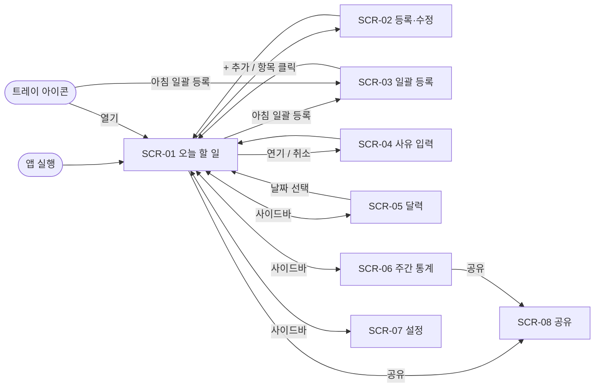

# TODOLIST 화면설계서

## 1. 개요

| 항목 | 내용 |
|---|---|
| 대상 플랫폼 | Windows 데스크톱 앱. 기준 창 크기 1280×800, 최소 960×640 (추정) |
| 디자인 원본 | TODO: Figma 링크 (없으면 아래 와이어프레임이 원본) |
| 사용자 권한 | 단일 사용자 (로그인 없음) |
| 관련 문서 | 요구사항정의서, API 명세서 |

## 2. 화면 목록

| SCR ID | 화면명 | 경로(URL) | 권한 | 관련 REQ | 상태 |
|---|---|---|---|---|---|
| SCR-01 | 오늘 할 일 (메인) | `#/day/:date` | 전체 | REQ-3, REQ-5, REQ-6, REQ-7, REQ-8, REQ-10, REQ-13, REQ-15, REQ-17 | 설계 중 |
| SCR-02 | 할 일 등록·수정 (모달) | SCR-01 위 모달 | 전체 | REQ-1, REQ-2, REQ-3, REQ-5, REQ-13, REQ-14, REQ-15, REQ-16 | 설계 중 |
| SCR-03 | 아침 일괄 등록 (모달) | SCR-01 위 모달 | 전체 | REQ-4 | 설계 중 |
| SCR-04 | 연기·취소 사유 입력 (모달) | SCR-01 위 모달 | 전체 | REQ-8, REQ-9 | 설계 중 |
| SCR-05 | 달력 | `#/calendar/:yyyy-mm` | 전체 | REQ-11 | 설계 중 |
| SCR-06 | 주간 통계 | `#/stats/week/:weekStart` | 전체 | REQ-12, REQ-17 | 설계 중 |
| SCR-07 | 설정 | `#/settings` | 전체 | REQ-14, REQ-15, REQ-16, REQ-18 | 설계 중 |
| SCR-08 | 공유 (모달) | SCR-01·SCR-06 위 모달 | 전체 | REQ-17 | 설계 중 |

## 3. 화면 흐름도



## 4. 공통 규칙

| 구분 | 규칙 |
|---|---|
| 레이아웃 | 좌측 사이드바(오늘 / 달력 / 주간 통계 / 설정) + 본문. 사이드바 하단에 오늘 상태 요약 |
| 공통 컴포넌트 | 버튼, 입력창, 체크박스, 상태 칩, 우선순위 칩, 태그 칩, 모달, 토스트, 날짜 선택기 |
| 상태 칩 색 | 대기 회색 / 진행 파랑 / 완료 초록 / 연기 주황 / 취소 빨강 |
| 우선순위 칩 | 높음 ▲ 빨강 / 보통 ● 노랑 / 낮음 ▼ 회색 |
| 메시지 | 저장 → 토스트 "저장되었습니다." / 삭제 → 토스트 "삭제되었습니다. [되돌리기]" (5초) |
| 빈 상태 · 로딩 · 오류 | 빈 상태는 안내 문구 + 다음 행동 버튼. 로컬 DB라 로딩은 0.3초 넘을 때만 스켈레톤 표시. 저장 실패는 토스트 + 재시도 |
| 날짜 · 숫자 형식 | 화면 표시 `YYYY-MM-DD (요일)`, 저장 `YYYY-MM-DD`. 완료율은 정수 % |
| 단축키 | `Ctrl+N` 추가, `Ctrl+Shift+N` 일괄 등록, `←` `→` 하루 이동, `T` 오늘로 (추정) |
| 창 닫기 · 트레이 | 창의 ✕를 누르면 종료하지 않고 트레이로 숨긴다(처음 한 번만 "트레이에서 계속 실행됩니다" 알림). 트레이 아이콘 클릭 → 창 열기. 트레이 메뉴: 열기 / 아침 일괄 등록 / 종료 |
| 과거 날짜 | 지난 날짜에서도 추가·수정·상태 변경을 허용한다. 지난 날짜의 대기·진행 항목은 자동 이월하지 않는다 |

## 5. 화면 상세

### SCR-01 오늘 할 일 (메인)

| 항목 | 내용 |
|---|---|
| 목적 | 선택한 날짜의 할 일을 우선순위대로 보고 처리한다 |
| 진입 경로 | 앱 실행(오늘), 사이드바 "오늘", SCR-05에서 날짜 선택 |
| 관련 REQ | REQ-3, REQ-5, REQ-6, REQ-7, REQ-8, REQ-10, REQ-13, REQ-15, REQ-17 |
| 사용 API | API-01, API-04, API-06, API-07 |

```text
┌──────────┬──────────────────────────────────────────────────────┐
│ ● 오늘   │ ◀  2026-10-26 (월)  ▶   [오늘]  [공유] [아침 일괄 등록] [+ 추가] │
│ ○ 달력   │ 대기 3 · 진행 1 · 완료 2 · 연기 1 · 취소 0     태그 [전체 ▾]   │
│ ○ 주간통계│──────────────────────────────────────────────────────│
│ ○ 설정   │ 할 일                                                 │
│          │ ☐ ▲ 제안서 초안 작성        [진행]  #업무  마감 10/27  ⋯   │
│          │ ☐ ▲ 고객 메일 회신          [대기]  #업무             ⋯   │
│          │ ☐ ● 운동 30분              [대기]  ↻ 매일            ⋯   │
│          │ ☐ ▼ 책상 정리              [대기]  연기됨(10/24)      ⋯   │
│          │ ── 처리됨 ─────────────────────────────────────────── │
│          │ ☑ ● 주간 회의              [완료]                     │
│ 오늘 2/7 │ ⤳ ● 은행 업무              [연기 → 10/28] 사유: 서류 미비  │
└──────────┴──────────────────────────────────────────────────────┘
```

TODO: 디자인 시안 이미지 `../assets/SCR-01.png`

**영역 설명**

| No | 영역 / 요소 | 유형 | 설명 · 동작 | 데이터 · API |
|---|---|---|---|---|
| 1 | 날짜 헤더 (◀ 날짜 ▶, 오늘) | Button | 하루씩 이동, "오늘"은 오늘로 이동. 날짜 클릭 시 날짜 선택기 | API-01 |
| 2 | 아침 일괄 등록 | Button | SCR-03 열기 | – |
| 3 | + 추가 | Button | SCR-02(등록) 열기. 날짜는 현재 날짜 | – |
| 4 | 상태 요약 | Text | 상태별 건수. 누르면 해당 상태로 필터 | API-01 |
| 5 | 태그 필터 | Select | 선택한 태그만 표시 | API-01, API-11 |
| 6 | 완료 체크박스 | Checkbox | 체크 → 완료, 해제 → 직전 상태. 연기·취소 항목은 비활성 | API-07 |
| 7 | 우선순위 칩 | Chip | 클릭 시 높음/보통/낮음 순환 변경 | API-03 |
| 8 | 할 일 행 | List item | 드래그로 같은 등급 안 순서 변경. 클릭 시 SCR-02(수정) | API-06 |
| 9 | 상태 칩 | Dropdown | 대기/진행/완료/연기/취소 선택. 연기·취소 선택 시 SCR-04 | API-07 |
| 10 | 보조 표시 | Text | 태그, 마감일(지나면 빨강), 반복 ↻, "연기됨(원래 날짜)" | API-01 |
| 11 | ⋯ 메뉴 | Menu | 수정 / 연기 / 취소 / 삭제 | API-04, API-07 |
| 12 | 처리됨 묶음 | Section | 완료·연기·취소 항목. 연기·취소는 사유를 함께 표시. 접기 가능 | API-01 |
| 13 | 공유 | Button | SCR-08(대상: 이 날짜 목록) 열기. 할 일이 없으면 비활성 | – |

**상태별 화면**

| 상태 | 표시 내용 |
|---|---|
| 로딩 | 행 스켈레톤 3줄 (0.3초 이상일 때만) |
| 데이터 없음 | "이 날짜에 할 일이 없습니다." + [아침 일괄 등록] [+ 추가] |
| 오류 | "목록을 불러오지 못했습니다." + [다시 시도] |

### SCR-02 할 일 등록·수정 (모달)

| 항목 | 내용 |
|---|---|
| 목적 | 할 일 하나를 추가하거나 고친다 |
| 진입 경로 | SCR-01 "+ 추가"(등록), 할 일 행 클릭(수정) |
| 관련 REQ | REQ-1, REQ-2, REQ-3, REQ-5, REQ-13, REQ-14, REQ-15, REQ-16 |
| 사용 API | API-02, API-03, API-04, API-08, API-11, API-15 |

```text
┌ 할 일 추가 ─────────────────────────────┐
│ 제목*   [                              ] │
│ 날짜*   [2026-10-26 📅]  우선순위 (▲)(●)(▼) │
│ 마감일  [          📅]  알림 [   :   ⏰]  │
│ 반복    [없음 ▾]  (매일/평일/매주/매월)     │
│ 태그    [#업무 ×] [+ 태그]                 │
│ 메모    [                              ] │
│ ─ 상태 이력 (수정 시) ───────────────────  │
│ 10/24 대기→연기 "서류 미비" → 10/26       │
│ [삭제]                     [취소] [저장]   │
└──────────────────────────────────────────┘
```

**영역 설명**

| No | 영역 / 요소 | 유형 | 설명 · 동작 | 데이터 · API |
|---|---|---|---|---|
| 1 | 제목 | Input | 필수 | API-02, API-03 |
| 2 | 날짜 | Date picker | 기본값 SCR-01의 현재 날짜 | API-02, API-03 |
| 3 | 우선순위 | Segmented | 기본값 보통 | API-02, API-03 |
| 4 | 마감일 | Date picker | 선택 입력 | API-02, API-03 |
| 5 | 알림 | Time picker | 선택 입력. 해당 날짜 그 시각에 OS 알림 | API-02, API-03 |
| 6 | 반복 | Select | 없음/매일/평일/매주(요일 선택)/매월(일자 선택). 반복 선택 시 반복 규칙 생성 | API-15 |
| 7 | 태그 | Tag input | 기존 태그 자동완성, 새 태그는 입력 후 Enter | API-11 |
| 8 | 메모 | Textarea | 선택 입력 | API-02, API-03 |
| 9 | 상태 이력 | List | 수정 모드에서만 표시 | API-08 |
| 10 | 삭제 | Button | 수정 모드에서만. 확인 후 삭제 | API-04 |
| 11 | 저장 | Button | 검증 통과 시 저장 후 닫기 | API-02, API-03 |

**상태별 화면**

| 상태 | 표시 내용 |
|---|---|
| 로딩 | 저장 버튼 비활성 + 스피너 |
| 데이터 없음 | 해당 없음 |
| 오류 | 필드 아래 오류 문구, 저장 실패 시 토스트 |

**입력 검증**

| 필드 | 필수 | 규칙 | 오류 메시지 |
|---|---|---|---|
| 제목 | Y | 1~200자, 공백만 불가 | "제목을 입력하세요." |
| 날짜 | Y | 유효한 날짜 | "날짜를 선택하세요." |
| 마감일 | N | 날짜 이후 또는 같은 날 (추정) | "마감일은 날짜보다 빠를 수 없습니다." |
| 메모 | N | 2,000자 이하 | "메모는 2,000자까지 입력할 수 있습니다." |
| 태그 | N | 태그명 1~20자, 할 일당 10개 이하 | "태그는 10개까지 붙일 수 있습니다." |

### SCR-03 아침 일괄 등록 (모달)

| 항목 | 내용 |
|---|---|
| 목적 | 그날 할 일을 여러 줄로 한 번에 올린다 |
| 진입 경로 | SCR-01 "아침 일괄 등록", 아침 알림 클릭 |
| 관련 REQ | REQ-4 |
| 사용 API | API-05 |

```text
┌ 아침 일괄 등록 ── 2026-10-26 (월) ───────┐
│ 한 줄에 하나씩 입력하세요.                 │
│ ┌──────────────────────────────────────┐ │
│ │ - 제안서 초안 작성                    │ │
│ │ - 고객 메일 회신                      │ │
│ │ - 운동 30분                           │ │
│ └──────────────────────────────────────┘ │
│ 미리보기: 3건  기본 우선순위 [보통 ▾]      │
│                         [취소] [3건 등록]  │
└──────────────────────────────────────────┘
```

**영역 설명**

| No | 영역 / 요소 | 유형 | 설명 · 동작 | 데이터 · API |
|---|---|---|---|---|
| 1 | 날짜 | Text | SCR-01의 현재 날짜 | – |
| 2 | 입력창 | Textarea | 한 줄 = 한 건. 목록 기호(`-`, `*`, `1.`)와 빈 줄은 무시 | – |
| 3 | 미리보기 건수 | Text | 입력하는 동안 유효 건수 갱신 | – |
| 4 | 기본 우선순위 | Select | 일괄 등록 건의 우선순위. 기본값 보통 | API-05 |
| 5 | 등록 | Button | 유효 건수가 0이면 비활성. 등록 후 SCR-01로 돌아가 새 항목 강조 | API-05 |

**상태별 화면**

| 상태 | 표시 내용 |
|---|---|
| 로딩 | 등록 버튼 스피너 |
| 데이터 없음 | 입력창 안내 문구 (placeholder) |
| 오류 | 200자 초과 줄을 빨간 밑줄로 표시하고 등록 버튼 비활성 |

**입력 검증**

| 필드 | 필수 | 규칙 | 오류 메시지 |
|---|---|---|---|
| 입력창 | Y | 유효한 줄 1~50건, 줄당 200자 이하 | "200자를 넘는 줄이 있습니다." / "한 번에 50건까지 등록할 수 있습니다." |

### SCR-04 연기·취소 사유 입력 (모달)

| 항목 | 내용 |
|---|---|
| 목적 | 연기·취소할 때 사유(와 연기 날짜)를 남긴다 |
| 진입 경로 | SCR-01 상태 칩에서 연기/취소 선택, ⋯ 메뉴 |
| 관련 REQ | REQ-8, REQ-9 |
| 사용 API | API-07 |

```text
┌ 연기하기 ───────────────────────┐   ┌ 취소하기 ───────────────────────┐
│ 은행 업무                        │   │ 책상 정리                        │
│ 연기 날짜* [내일][다음 주][📅]   │   │ 사유* [                       ] │
│ 사유*     [                   ] │   │ 최근 사유: 필요 없어짐 · 중복     │
│ 최근 사유: 서류 미비 · 시간 부족  │   │              [닫기] [취소 처리] │
│              [닫기] [연기]       │   └──────────────────────────────────┘
└──────────────────────────────────┘
```

**영역 설명**

| No | 영역 / 요소 | 유형 | 설명 · 동작 | 데이터 · API |
|---|---|---|---|---|
| 1 | 할 일 제목 | Text | 대상 확인용 | – |
| 2 | 연기 날짜 (연기만) | Date picker + 빠른 선택 | 내일 / 다음 주 월요일 / 직접 선택 | API-07 |
| 3 | 사유 | Input | 필수 | API-07 |
| 4 | 최근 사유 | Chip | 최근에 쓴 사유 5개. 누르면 입력 (추정) | API-08 |
| 5 | 연기 / 취소 처리 | Button | 검증 통과 시 저장. 연기는 새 날짜에 할 일 생성 | API-07 |

**상태별 화면**

| 상태 | 표시 내용 |
|---|---|
| 로딩 | 버튼 스피너 |
| 데이터 없음 | 최근 사유가 없으면 칩 영역 숨김 |
| 오류 | 필드 아래 오류 문구 |

**입력 검증**

| 필드 | 필수 | 규칙 | 오류 메시지 |
|---|---|---|---|
| 사유 | Y | 1~200자 | "사유를 입력하세요." |
| 연기 날짜 | Y (연기) | 원래 날짜보다 뒤 | "연기 날짜는 원래 날짜보다 뒤여야 합니다." |

### SCR-05 달력

| 항목 | 내용 |
|---|---|
| 목적 | 이전·이후 날짜를 골라 그날 할 일을 본다 |
| 진입 경로 | 사이드바 "달력", SCR-01 날짜 클릭 |
| 관련 REQ | REQ-11 |
| 사용 API | API-09 |

```text
┌──────────┬───────────────────────────────────────────┐
│ 사이드바 │ ◀  2026년 10월  ▶                 [오늘]     │
│          │  월    화    수    목    금    토    일     │
│          │  …                                          │
│          │  26    27    28    29    30    31          │
│          │  2/7   0/3   ·1                            │
│          │  ●●○   ○○○   ○                             │
└──────────┴───────────────────────────────────────────┘
```

**영역 설명**

| No | 영역 / 요소 | 유형 | 설명 · 동작 | 데이터 · API |
|---|---|---|---|---|
| 1 | 월 이동 | Button | 이전 달 / 다음 달 / 오늘 | API-09 |
| 2 | 날짜 칸 | Cell | "완료/전체" 건수와 상태 점(최대 5개). 오늘은 테두리 강조 | API-09 |
| 3 | 날짜 선택 | Action | 클릭 시 SCR-01 해당 날짜로 이동 | – |

**상태별 화면**

| 상태 | 표시 내용 |
|---|---|
| 로딩 | 달력 틀만 먼저 표시 |
| 데이터 없음 | 할 일 없는 날은 빈 칸 |
| 오류 | "달력을 불러오지 못했습니다." + [다시 시도] |

### SCR-06 주간 통계

| 항목 | 내용 |
|---|---|
| 목적 | 한 주의 완료·진행·대기·연기·취소 결과를 본다 |
| 진입 경로 | 사이드바 "주간 통계" |
| 관련 REQ | REQ-12, REQ-17 |
| 사용 API | API-10 |

```text
┌──────────┬───────────────────────────────────────────┐
│ 사이드바 │ ◀  2026-10-26 ~ 11-01  ▶    [이번 주] [공유] │
│          │ 완료율 68%   전체 25 · 완료 15 · 진행 2       │
│          │             대기 3 · 연기 4 · 취소 1          │
│          │ 요일별 (누적 막대)                             │
│          │ 월 ████▒▒░  화 ███▒░  수 …                    │
│          │ 연기 사유            취소 사유                 │
│          │ 서류 미비 2           필요 없어짐 1             │
│          │ 시간 부족 2                                    │
│          │ 2회 이상 연기된 할 일: 은행 업무 (2회)          │
└──────────┴───────────────────────────────────────────┘
```

**영역 설명**

| No | 영역 / 요소 | 유형 | 설명 · 동작 | 데이터 · API |
|---|---|---|---|---|
| 1 | 주 이동 | Button | 이전 주 / 다음 주 / 이번 주. 한 주 = 월~일 (추정) | API-10 |
| 2 | 요약 | Stat tile | 완료율, 전체, 상태별 건수 | API-10 |
| 3 | 요일별 추이 | Stacked bar | 요일별 상태 건수. 막대 클릭 시 SCR-01 해당 날짜 | API-10 |
| 4 | 연기·취소 사유 | List | 사유별 건수 | API-10 |
| 5 | 반복 연기 | List | 같은 할 일이 2회 이상 연기된 경우 | API-10 |
| 6 | 공유 | Button | SCR-08(대상: 이 주 통계) 열기. 할 일이 없는 주는 비활성 | – |

**상태별 화면**

| 상태 | 표시 내용 |
|---|---|
| 로딩 | 타일·그래프 스켈레톤 |
| 데이터 없음 | "이 주에는 기록된 할 일이 없습니다." |
| 오류 | "통계를 불러오지 못했습니다." + [다시 시도] |

### SCR-07 설정

| 항목 | 내용 |
|---|---|
| 목적 | 태그, 반복 규칙, 알림, 백업을 관리한다 |
| 진입 경로 | 사이드바 "설정" |
| 관련 REQ | REQ-14, REQ-15, REQ-16, REQ-18 |
| 사용 API | API-11, API-12, API-13, API-14, API-15, API-16, API-17, API-18, API-19 |

**영역 설명**

| No | 영역 / 요소 | 유형 | 설명 · 동작 | 데이터 · API |
|---|---|---|---|---|
| 1 | 태그 관리 | Table | 태그 이름·색 수정, 삭제 (삭제 시 할 일에서 떼어냄) | API-11, API-12, API-13 |
| 2 | 반복 규칙 | Table | 규칙 목록, 수정, 중지, 삭제 | API-14, API-15, API-16 |
| 3 | 아침 등록 알림 | Toggle + Time | 켜면 지정 시각에 "오늘 할 일을 등록하세요" 알림. 알림 클릭 시 SCR-03 | API-17, API-18 |
| 4 | 할 일 알림 | Toggle | 할 일별 알림 전체 켜기/끄기 | API-17, API-18 |
| 5 | 백업 내보내기 | Button | DB 파일 또는 JSON으로 저장 위치 선택 후 내보내기 | API-19 |

**상태별 화면**

| 상태 | 표시 내용 |
|---|---|
| 로딩 | 섹션별 스켈레톤 |
| 데이터 없음 | 태그·반복 규칙이 없으면 "아직 없습니다." |
| 오류 | 저장 실패 토스트 |

**입력 검증**

| 필드 | 필수 | 규칙 | 오류 메시지 |
|---|---|---|---|
| 태그 이름 | Y | 1~20자, 중복 불가 | "이미 있는 태그입니다." |
| 알림 시각 | Y (알림 켬) | HH:mm | "시각을 선택하세요." |

### SCR-08 공유 (모달)

| 항목 | 내용 |
|---|---|
| 목적 | 하루 목록이나 주간 통계를 텍스트 또는 이미지로 내보낸다 |
| 진입 경로 | SCR-01 "공유", SCR-06 "공유" |
| 관련 REQ | REQ-17 |
| 사용 API | API-20 |

```text
┌ 공유 ── 2026-10-26 (월) 할 일 ─────────────┐
│ 형식   (●) 텍스트   ( ) 이미지              │
│ ┌ 미리보기 ──────────────────────────────┐ │
│ │ 📋 2026-10-26 (월) 할 일 2/7 완료       │ │
│ │ ☑ 주간 회의                             │ │
│ │ ☐ ▲ 제안서 초안 작성 (진행)             │ │
│ │ ⤳ 은행 업무 → 10/28 (서류 미비)         │ │
│ └────────────────────────────────────────┘ │
│            [닫기] [PNG로 저장] [클립보드 복사] │
└────────────────────────────────────────────┘
```

**영역 설명**

| No | 영역 / 요소 | 유형 | 설명 · 동작 | 데이터 · API |
|---|---|---|---|---|
| 1 | 제목 | Text | 대상(날짜 목록 / 주간 통계)과 날짜·기간 | – |
| 2 | 형식 | Radio | 텍스트(기본) / 이미지. 마지막 선택을 기억한다 | – |
| 3 | 미리보기 | Preview | 텍스트는 실제 복사될 문자열, 이미지는 렌더링 결과 | API-20 |
| 4 | PNG로 저장 | Button | 이미지 형식일 때만 표시. 저장 대화상자 | API-20 |
| 5 | 클립보드 복사 | Button | 복사 후 토스트 "복사되었습니다." 그리고 닫기 | API-20 |

**상태별 화면**

| 상태 | 표시 내용 |
|---|---|
| 로딩 | 미리보기 스켈레톤 |
| 데이터 없음 | 진입 버튼이 비활성이라 발생하지 않음 |
| 오류 | "공유 내용을 만들지 못했습니다." + [다시 시도] |

## 변경 이력

| 버전 | 날짜 | 작성자 | 변경 내용 |
|---|---|---|---|
| 0.1 | 2026-10-26 | Jinny | 최초 작성 (SCR-01~07) |
| 0.2 | 2026-10-26 | Jinny | SCR-08 공유 추가, 트레이·과거 날짜 공통 규칙 추가 |
